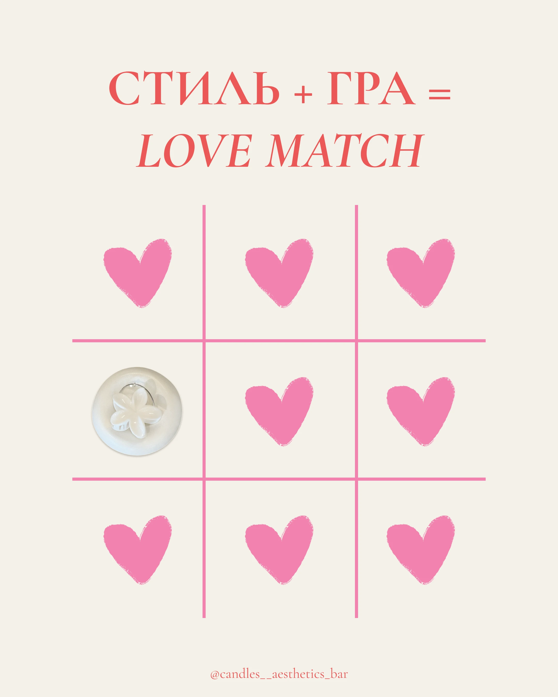

# Cream 'Style + Game = Love Match' post with a pink tic-tac-toe of hearts and one product cell

**Discipline:** print-social ·  · **Design style:** Editorial
**Tags:** game, tic-tac-toe, hearts, pink, coral, serif, cream, candle-shop

## What it is
A cream post with a coral serif headline (second line italic) over a pink tic-tac-toe grid where eight cells hold brushy pink hearts and one holds a white round dish with a flower clip, and a small handle at the bottom.

## What it means
Sweet and playful; a familiar game turns a product into the winning move.

## Techniques
- Use a well-known game grid as layout.
- Fill cells with one repeated shape and one exception.
- Set serif headline in coral with an italic line.
- Keep it cream and pink.

## Best for
- Interactive-looking product posts
- Valentine and gift promos
- Grid-based concept posts

## Vocabulary
- **Game layout** — A game board used as design structure.
- **Odd-one-out** — One different item among repeated ones.
- **Brush heart** — A heart with a rough painted edge.
- **Italic second line** — The second headline line set in italic.
