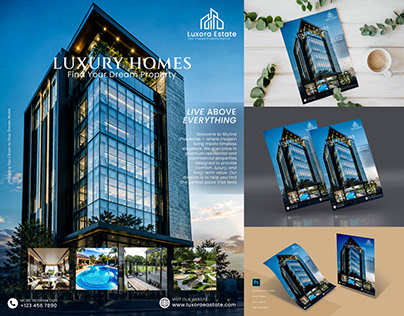

# Real-estate flyer collage: skyscraper photo, contact footer and stacked mockups

**Discipline:** print-social · **Design type:** Product flyer
**Tags:** flyer, real-estate, luxury, blue, glass-tower, mockup, dusk, collage

## What it is
A collage: at left a large dusk photo of a glass tower with headline 'LUXURY HOMES' in white serif, a subhead, a paragraph and a row of interior photos with contact details; at right three mockups of the flyer on white desk with leaves and a coffee, on grey and on tan paper.

## What it means
Premium and aspirational; the deep blue dusk and glowing windows suggest high-end living.

## Techniques
- Use a dramatic dusk tower photo as a full-height backdrop.
- Set the headline in a light serif in white.
- Add a strip of small interior photos as proof.
- Show the flyer on several surfaces to prove print flexibility.

## Best for
- Property and development flyers
- Print collateral for premium services
- Portfolio mockup collages

## Vocabulary
- **Dusk photography** — Photos taken at twilight with lit windows.
- **Photo strip** — A row of small images along an edge.
- **Flyer mockup** — A presentation of a flyer on a realistic surface.
- **Contact footer** — A bottom band with phone and web details.
