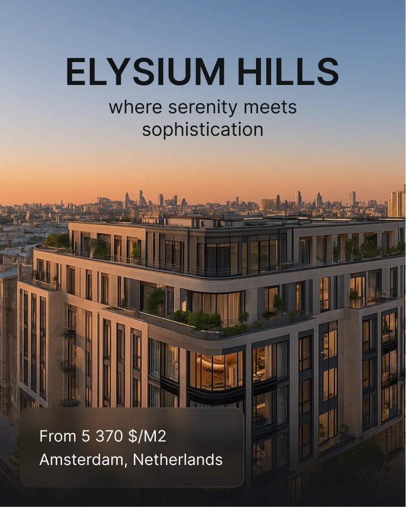

# Property post with dusk skyline, centred caps title and glass info card

**Discipline:** print-social · **Design type:** Social ad
**Tags:** real-estate, luxury, dusk, photo-overlay, glass-card, centered-title, portrait

## What it is
A tall image of a modern apartment building at sunset over a city skyline. A dark bold 'ELYSIUM HILLS' and a light tagline sit in the sky. At the bottom left a frosted brown glass card shows price per square metre and city.

## What it means
Serene and premium; text in the clear sky and a quiet glass card keep the photo dominant.

## Techniques
- Place headline text in the clear part of the sky for legibility.
- Overlay a translucent card for price and location.
- Use a warm gradient sky against a cool blue-grey top.
- Keep type minimal: bold caps title plus light tagline.

## Best for
- Real-estate and development promos
- Luxury service ads
- Photo-led announcements

## Vocabulary
- **Sky text** — Text placed over the clear sky area of a photo.
- **Glass info card** — A frosted translucent box holding key facts.
- **Golden hour** — Warm light near sunset.
- **Price line** — A short line stating cost and place.
