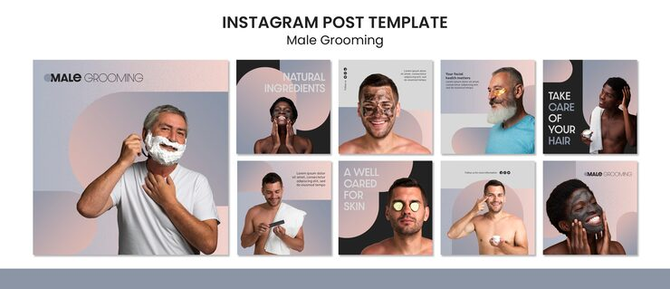

# Male grooming pack with blush-to-blue gradients, arch shapes and thin uppercase type

**Discipline:** print-social · **Design type:** Social template pack · **Design style:** Minimalist
**Tags:** grooming, men, skincare, blush, gradient, arch

## What it is
Nine square posts with soft blush-to-grey-blue gradients, arch and half-circle shapes behind men applying shaving foam, face masks and cucumber slices, thin letter-spaced headlines ('NATURAL INGREDIENTS', 'TAKE CARE OF YOUR HAIR') and a 'Male Grooming' wordmark.

## What it means
Calm and modern; soft pastel gradients make male self-care feel gentle and normal.

## Techniques
- Use soft pastel gradients for a spa mood.
- Place arches behind subjects as a halo.
- Set headlines in thin spaced caps.
- Show candid care moments with humour.

## Best for
- Men's skincare
- Barbershops
- Wellness brands

## Vocabulary
- **Halo shape** — A shape behind a subject that frames the head.
- **Tracking** — Uniform spacing between letters.
