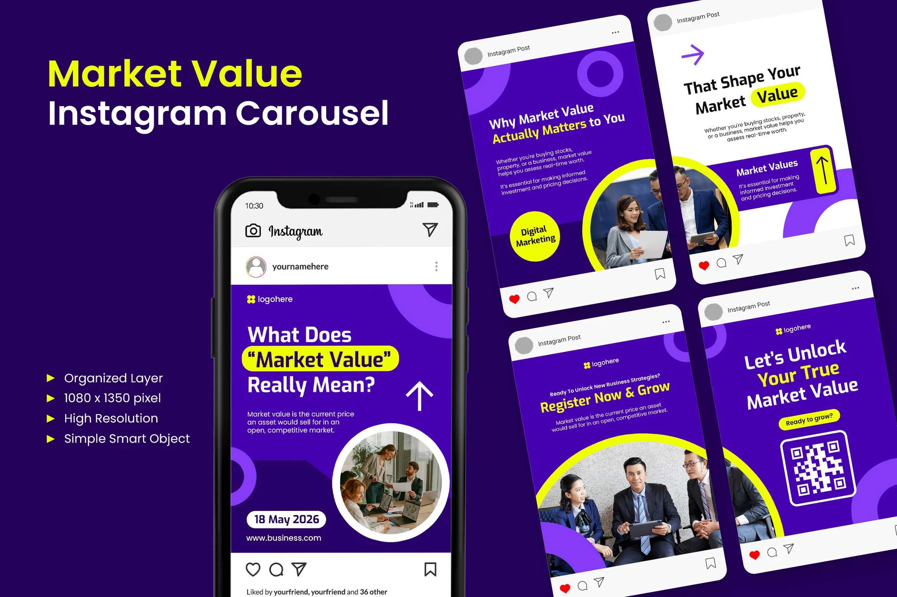

# 'Market Value Instagram Carousel' mockup on a phone and tilted Instagram post frames

**Discipline:** print-social · **Design type:** Feed mockup · **Design style:** Corporate & Clean-Tech
**Tags:** mockup, instagram, carousel, violet, lime, template-preview

## What it is
A deep indigo presentation with a lime and white title 'Market Value Instagram Carousel', a feature list (Organized Layer, 1080x1350, High Resolution), a phone showing the violet carousel in Instagram UI, and four tilted Instagram post frames displaying the other slides.

## What it means
Sales-ready and contextual; showing posts inside real Instagram chrome proves how they will look.

## Techniques
- Place designs inside realistic app frames.
- Tilt a grid of frames for dynamism.
- List file specs as arrow bullets beside the mockup.

## Best for
- Template marketplace previews
- Social media product listings
- Client presentations

## Vocabulary
- **Mockup** — A realistic preview of a design in context.
- **App chrome** — The interface frame around content.
