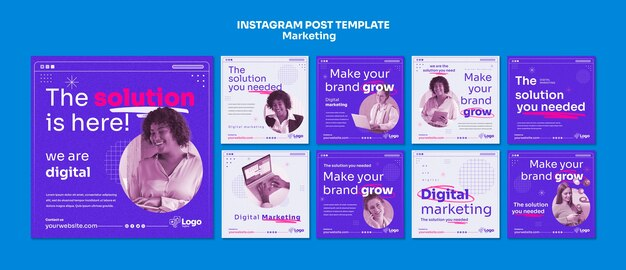

# Marketing pack in violet and white with pink highlighter words, halftone photos and grid lines

**Discipline:** print-social · **Design type:** Social template pack · **Design style:** Retro & Pixel
**Tags:** marketing, violet, pink, halftone, grid, highlight

## What it is
Nine square posts in violet and white with a fine grid, violet halftone-tinted photos of smiling people, headlines like 'The solution is here!' and 'Make your brand grow' where a word is hot pink with a scribbled highlighter stroke, sparkle stars and browser dots.

## What it means
Upbeat and digital; halftone and highlighter strokes give a printed, hand-marked energy.

## Techniques
- Tint photos in a halftone of the brand colour.
- Mark key words with a scribbled highlighter stroke.
- Use a faint grid for a digital notebook feel.

## Best for
- Digital marketing agencies
- Online courses
- Brand growth content

## Vocabulary
- **Highlighter stroke** — A rough marker line behind a word.
- **Halftone tint** — A dot-screened photo in one colour.
