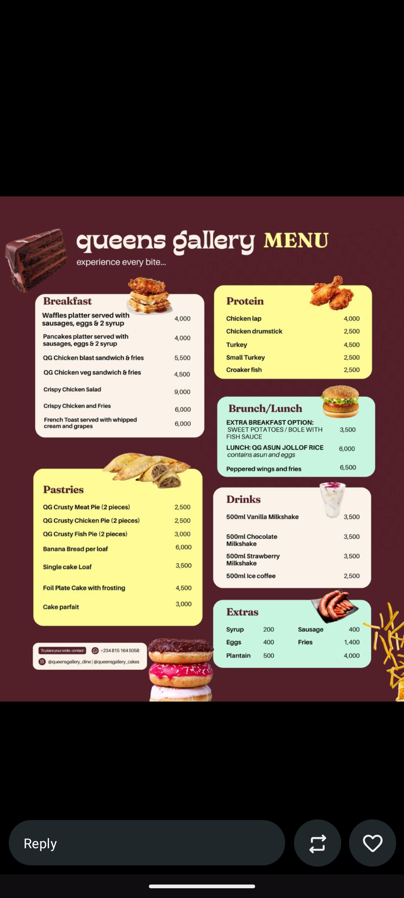

# Maroon Cafe Menu with Yellow and Mint Cards

**Discipline:** print-social ·  · **Design style:** Photographic & Cinematic
**Tags:** menu, food, maroon, yellow, mint, cream, cutouts, price-list

## What it is
A square menu on deep maroon with a cream script-like brand title and a yellow serif MENU, and rounded cards in cream, yellow and mint for Breakfast, Protein, Brunch/Lunch, Pastries, Drinks and Extras, each with serif headings, item names with right-aligned prices and a cut-out food photo breaking out of the card corner, with a contact strip and stacked donuts.

## What it means
Colour-blocked cards make a long menu easy to scan, and photos poking out of the corners make it feel appetising.

## Techniques
- Colour-coded cards per menu section
- Cut-out food photos overlapping card corners
- Serif section headings over bold sans items
- Right-aligned price column
- Maroon ground to make the pastel cards pop

## Best for
- Restaurant and cafe menus
- Food promo flyers
- Price-list layouts

## Vocabulary
- **Menu card** — A rounded panel grouping one section of a menu.
- **Corner cut-out** — An image that breaks out of its container's corner.
- **Price column** — A right-aligned list of prices for scanning.
