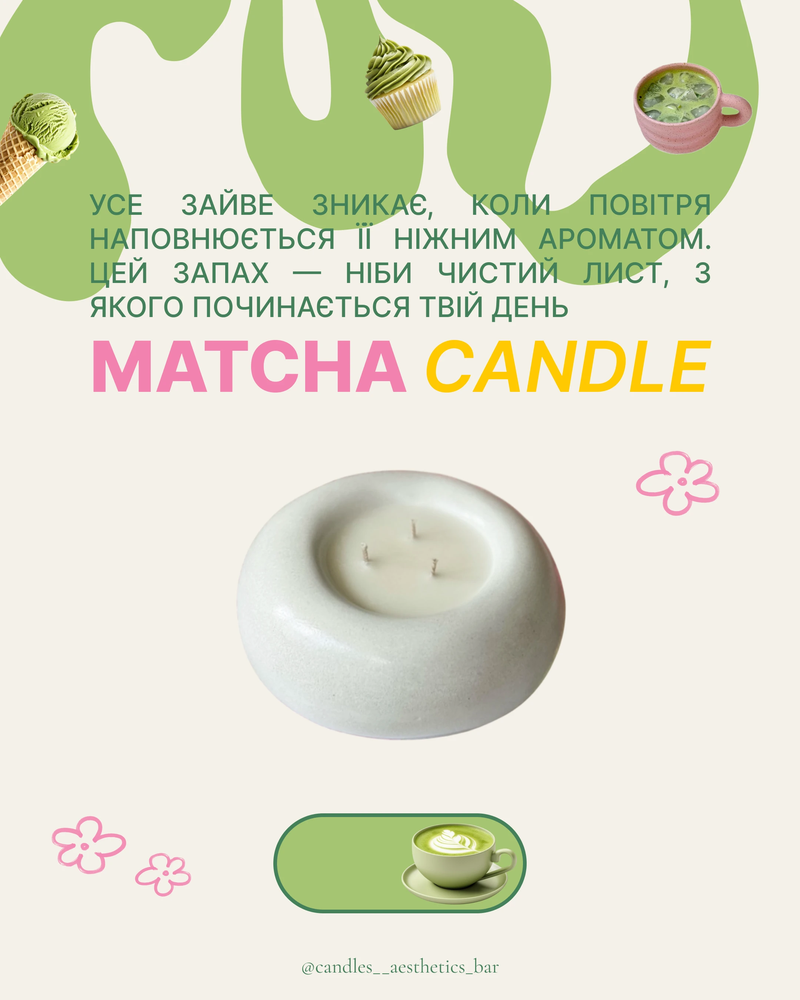

# Matcha candle post: melting green shapes, pink and yellow title and matcha cutouts

**Discipline:** print-social · **Design type:** Social promo post
**Tags:** product, candle, matcha, green, pink, yellow, blob, doodle-flowers, cyrillic

## What it is
A cream post with big wavy light-green blobs at the top holding cutouts of matcha ice cream, cupcake and iced latte. Justified green caps text sits over them, a bold pink 'MATCHA' and yellow italic 'CANDLE' title, a large white round candle, pink line-drawn flowers, and a green pill with a latte cup.

## What it means
Fresh and sweet; food cutouts tell the scent story.

## Techniques
- Let organic blobs frame cutouts.
- Colour title words in pink and yellow, one in italic.
- Show the hero product large in the middle.
- Add pink doodle flowers.

## Best for
- Scented candle and home-fragrance launches
- Food-inspired product posts
- Playful lifestyle branding

## Vocabulary
- **Blob frame** — Organic shapes that surround content.
- **Scent story cutouts** — Images of ingredients that suggest a fragrance.
- **Italic contrast** — One word in italic to differ from its neighbour.
- **Doodle flower** — A simple hand-drawn flower.
