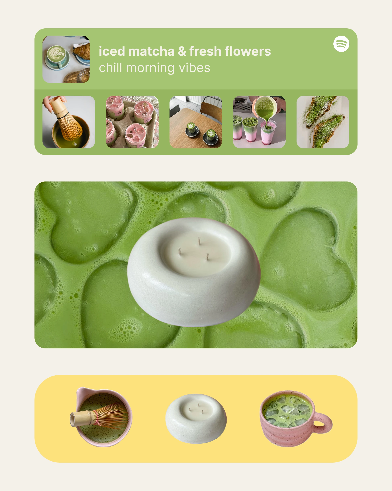

# Matcha moodboard with playlist widget, candle and yellow pill

**Discipline:** print-social · **Design type:** Moodboard post
**Tags:** moodboard, matcha, green, yellow, rounded-cards, playlist-widget, product-cutout, cream

## What it is
A cream 4:5 collage with three rounded blocks: a green playlist widget with a Spotify logo and five matcha photos, a full-width photo of frothy matcha with a floating white candle, and a yellow pill holding cut-outs of a whisk bowl, candle and pink cup.

## What it means
Calm, aesthetic and cosy; the single green palette signals wellness and a soft lifestyle.

## Techniques
- Borrow a familiar UI (music widget) as a layout to frame photos.
- Stack rounded rectangles of different sizes to build a soft modular collage.
- Keep the palette to green, cream and one sunny yellow.
- Isolate objects in a pill strip for a product line-up.

## Best for
- Lifestyle and wellness moodboards
- Candle, ceramic and café brands
- Brand story slides

## Vocabulary
- **Widget layout** — Layout imitating a UI component like a music card.
- **Rounded block collage** — Modular rounded rectangles arranged like a bento.
- **Product strip** — A row of isolated objects on a colour band.
- **Tonal photography** — Photos chosen to share one hue.
