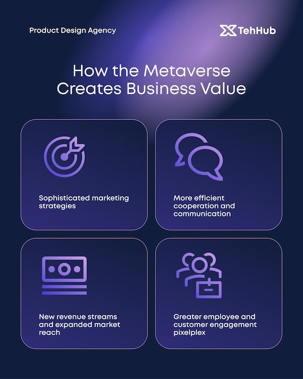

# 'How the Metaverse Creates Business Value' post with four violet line-icon cards

**Discipline:** print-social · **Design type:** Social educational post · **Design style:** Gradient & Aurora
**Tags:** metaverse, business, violet, navy, icons, cards

## What it is
A portrait navy post with a lavender light beam from the top, 'Product Design Agency' and 'TehHub' logos, a centred headline, and a 2x2 grid of rounded outlined cards with large violet line icons (target, chat bubbles, banknote, people) and short benefit text.

## What it means
Calm and credible; big line icons make abstract benefits concrete.

## Techniques
- Use large line icons as card heroes.
- Shine a soft light beam from above.
- Keep cards outlined and transparent.

## Best for
- Tech explainers
- Agency content
- Benefit summaries

## Vocabulary
- **Line icon** — An icon drawn with strokes, not fills.
- **Light beam** — A soft diagonal glow suggesting a spotlight.
