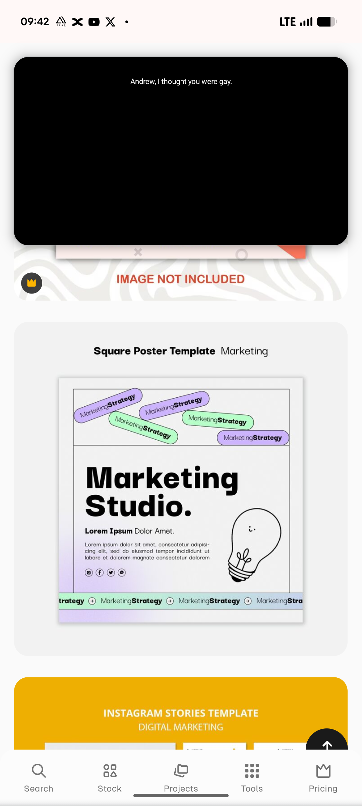

# Marketing Studio Poster with Tilted Strategy Pills

**Discipline:** print-social ·  · **Design style:** Playful & Illustrated
**Tags:** poster, marketing, lilac, mint, tilted-pills, line-art, lightbulb, ticker

## What it is
A square poster template with a ruled frame, a strip at the top of tilted lilac and mint pills reading MarketingStrategy, a heavy black 'Marketing Studio.' headline, a line-art smiling lightbulb, small social icons and a scrolling ticker of the same words along the base with a lilac-to-mint wash.

## What it means
Tilted pills scattered like stickers and a hand-drawn bulb keep a marketing message friendly and light.

## Techniques
- Pills scattered at different angles as stickers
- Heavy headline against fine ruled frame
- Line-art mascot object
- Ticker strip with arrow icons at the base
- Soft pastel gradient wash in the corners

## Best for
- Studio and agency posters
- Playful marketing templates
- Pill sticker layouts

## Vocabulary
- **Sticker pill** — A rounded label placed at an angle like a sticker.
- **Ticker strip** — A repeating band of words with arrows.
- **Line-art mascot** — A simple outlined drawing with a face used as a character.
