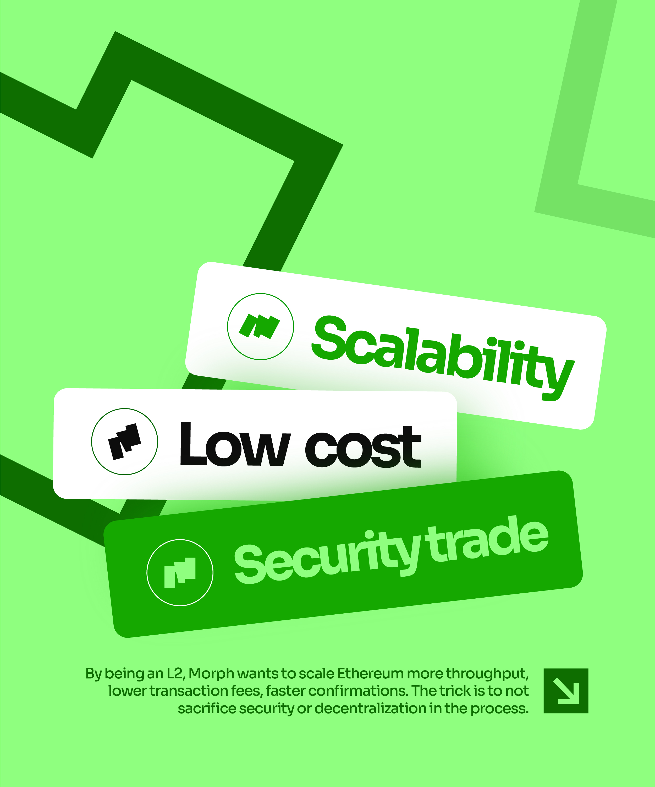

# Tilted Stacked Pills Scalability Slide

**Discipline:** print-social · **Design type:** Social carousel
**Tags:** carousel, mint, green, tilted-pills, icons, zigzag, blockchain

## What it is
A mint green portrait slide with dark and pale green zigzag strokes and three tilted rounded cards stacked in a cascade, 'Scalability' in green, 'Low cost' in black and 'Security trade' in white on solid green, each beside a circled logo mark, with a caption and arrow tile below.

## What it means
Tilted stacked cards make three attributes feel like a set of tags and add motion to a static slide.

## Techniques
- Tilted stacked cards cascading down
- Three colour treatments (green, black, white on green)
- Circled brand mark in each card
- Zigzag lines behind for depth
- Arrow tile beside the caption

## Best for
- Three-point feature slides
- Tech carousels
- Playful stacked card layouts

## Vocabulary
- **Cascade stack** — Cards overlapped in a descending staggered pile.
- **Tilted card** — A card rotated slightly for energy.
- **Mark badge** — A circled logo used as an icon.
