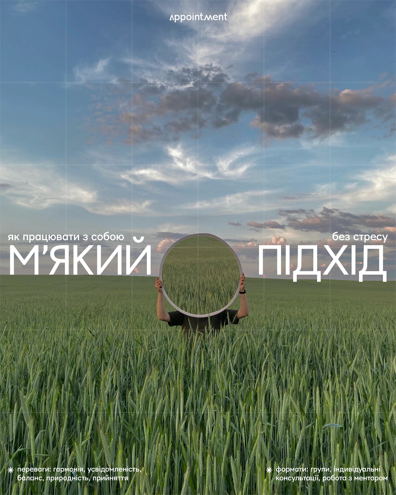

# Person holding a round mirror in a wheat field, headline split around it under a big sky

**Discipline:** print-social · **Design type:** Social cover post
**Tags:** wellness, photo, field, mirror, white-caps, split-headline, sky, cyrillic

## What it is
A vertical photo of a green field and cloudy blue sky where a person hides behind a circular mirror reflecting the field. White geometric caps 'М'ЯКИЙ' and 'ПІДХІД' sit on either side of the mirror with small captions above and two asterisk-bulleted notes at the bottom.

## What it means
Reflective and gentle; the mirror shows the landscape instead of a face.

## Techniques
- Split a headline around the central object.
- Use a surreal prop (mirror) with nature.
- Leave big sky as breathing space.
- Put small notes in the bottom corners.

## Best for
- Therapy and self-work content
- Nature-photo covers
- Symmetrical headline layouts

## Vocabulary
- **Split headline** — A headline divided around an object.
- **Surreal prop** — An object used to create a dreamlike image.
- **Corner notes** — Small bulleted text in the lower corners.
- **Sky space** — Empty sky left as room.
