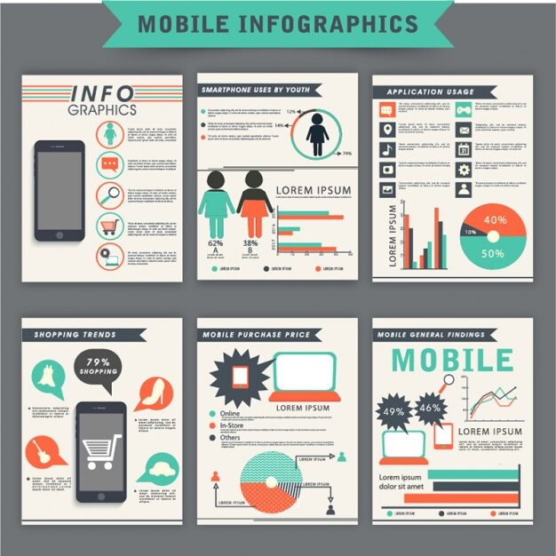

# 'Mobile Infographics' pack: six cards with a teal ribbon header covering usage stats, app trends and pricing

**Discipline:** print-social · **Design type:** Product infographic set · **Design style:** Corporate & Clean-Tech
**Tags:** infographic, mobile, teal-ribbon, stats, icons, pack

## What it is
Six white infographic cards under a teal ribbon 'Mobile Infographics' banner, covering: an intro with a phone and icon list, 'Smartphone Uses by Youth' with a pie chart and figures, 'Application Usage' with icon grids and a donut chart, 'Shopping Trends' with speech bubbles, 'Mobile Purchase Price' with a pie chart, and 'Mobile General Findings' with a line chart.

## What it means
Comprehensive and modular; six distinct card types cover an entire mobile-usage report while staying visually consistent.

## Techniques
- Package multiple chart types as a matched card set.
- Top every card with the same ribbon banner for branding.
- Mix icons, figures and charts within a single card for variety.

## Best for
- Mobile usage reports
- Market research infographics
- Multi-card infographic kits

## Vocabulary
- **Card set** — A group of matching infographic panels covering different data.
- **Ribbon banner** — A title shape with folded, flag-like ends.
