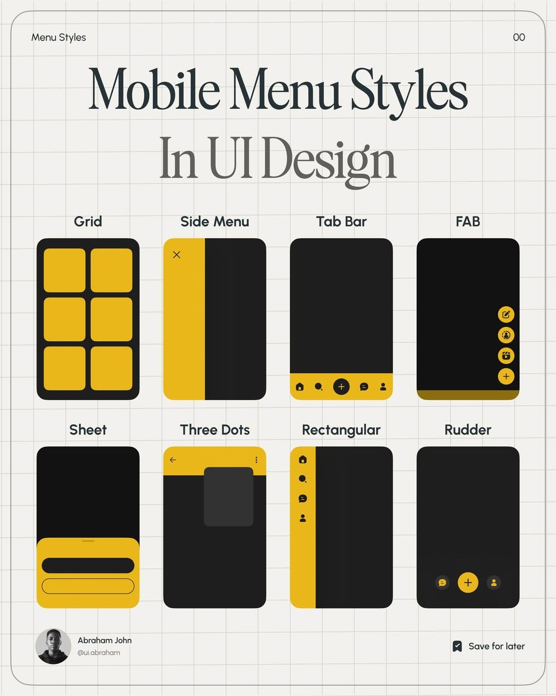

# Mobile menu pattern cheat sheet: eight charcoal phone diagrams with mustard highlights and a serif title

**Discipline:** print-social · **Design type:** Social educational post
**Tags:** ui-education, cheat-sheet, yellow, charcoal, grid-paper, serif-title, diagram, carousel

## What it is
A 4:5 post on cream grid paper inside a rounded keyline with a big serif 'Mobile Menu Styles In UI Design' (second line grey), two rows of four simple charcoal phones with mustard shapes labelled Grid, Side Menu, Tab Bar, FAB, Sheet, Three Dots, Rectangular and Rudder, plus an author avatar and a save prompt.

## What it means
Clear and collectable; simplified diagrams make patterns instantly comparable.

## Techniques
- Reduce each pattern to a flat two-colour phone.
- Label above each diagram in a rounded sans.
- Use a big serif title on grid paper.
- Add author and save cues at the base.

## Best for
- UI and design education posts
- Cheat sheets and taxonomies
- Saveable reference carousels

## Vocabulary
- **Pattern diagram** — A simplified drawing of a UI pattern.
- **Two-colour system** — Diagrams limited to two colours.
- **Grid-paper ground** — A ruled square background.
- **Save cue** — A prompt to bookmark the post.
