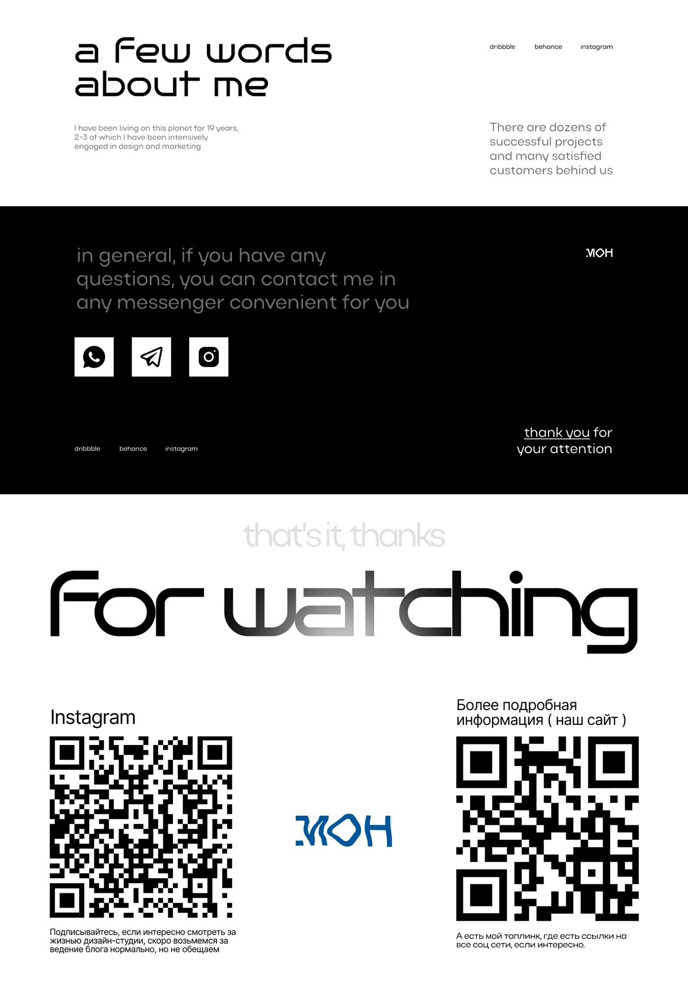

# Wide-tech-type closing slide with QR codes

**Discipline:** print-social ·  · **Design style:** Gradient & Aurora
**Tags:** presentation, typography, black-and-white, qr-code, portfolio, extended-type, gradient-text

## What it is
A three-part portfolio ending: a white 'a few words about me' block in wide geometric type, a black contact band with square social icons, and a huge 'For watching' with the middle letters fading to grey above two QR codes and a small blue logo.

## What it means
Minimal and self-assured, like a designer's sign-off; big type and monochrome keep attention on the call to scan.

## Techniques
- Set a huge closing phrase in wide techno-rounded type with a gradient fade across letters.
- Alternate white and black bands to separate topics.
- Use giant QR codes as the main graphic with tiny captions.
- Keep social links as small lowercase text and square white icons.

## Best for
- Portfolio and pitch closing slides
- Personal brand deliverables
- Calls to follow or scan

## Vocabulary
- **Extended geometric type** — Wide letterforms built from circles and lines.
- **Gradient text** — Letters that fade from solid to transparent.
- **Band layout** — Horizontal colour bands dividing content.
- **QR call-to-action** — A scannable code as the main action.
