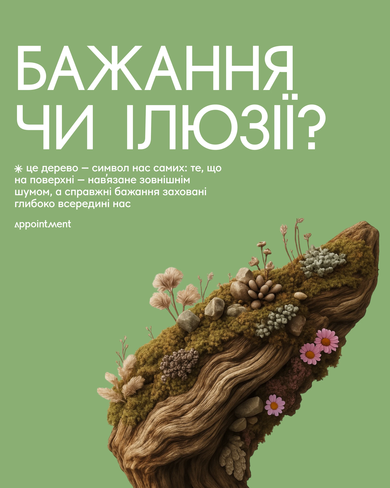

# Sage-green post with giant white question, small body copy and a mossy driftwood still life

**Discipline:** print-social · **Design type:** Social cover post
**Tags:** wellness, green, white-caps, still-life, moss, driftwood, cyrillic, metaphor

## What it is
A flat sage-green portrait with a huge white geometric caps question over two lines, a small paragraph with an asterisk bullet, a wordmark, and a cutout of a mossy driftwood piece with lichens and flowers rising diagonally at the lower right.

## What it means
Contemplative and organic; the tree is a metaphor for hidden desires.

## Techniques
- Set a huge question as the headline.
- Use a single object cutout as the image.
- Keep a flat colour background.
- Angle the object diagonally.

## Best for
- Reflective wellness posts
- Metaphor covers
- One-object compositions

## Vocabulary
- **Object metaphor** — An object standing in for an idea.
- **Flat field** — A single-colour background.
- **Diagonal cutout** — A cutout placed at an angle.
- **Question headline** — A headline phrased as a question.
