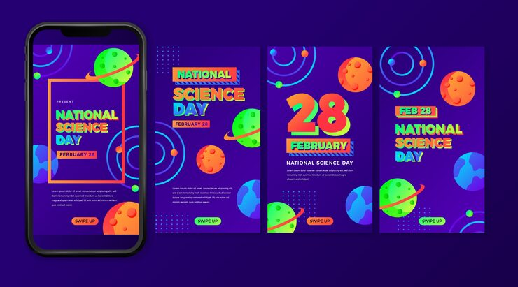

# National Science Day story set on indigo gradients with orbiting planets and giant coloured numerals

**Discipline:** print-social · **Design type:** Story set · **Design style:** Gradient & Aurora
**Tags:** science-day, space, indigo, gradient, planets, story

## What it is
Four vertical indigo-to-purple gradient story cards with illustrated orbiting ringed planets, dot-grid texture, bold multi-colour condensed headlines ('National Science Day', '28 February'), a giant numeral '28' as a hero element, and green 'Swipe Up' buttons.

## What it means
Playful and cosmic; orbiting planets and a giant date numeral make an academic observance day feel like a fun space adventure.

## Techniques
- Illustrate simple ringed planets as a space motif.
- Make the date itself a giant hero graphic on one card.
- Colour each letter of a headline differently for a playful rainbow effect.

## Best for
- Science education campaigns
- Awareness day promotion
- Space-themed branding

## Vocabulary
- **Hero numeral** — A number rendered extremely large as the focal graphic.
- **Rainbow headline** — A headline where each letter or word uses a different colour.
