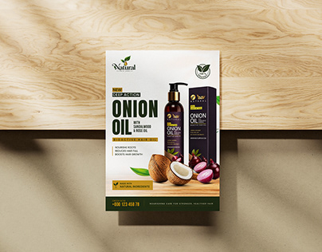

# Onion oil hair-care flyer mocked up on light wood

**Discipline:** print-social · **Design type:** Product flyer
**Tags:** flyer, product, natural, green-and-white, botanical, mockup, hair-care

## What it is
An A5-style flyer mockup on pale wood with hard shadows. It shows a bottle and box, coconuts and onions, a bold black product name, ingredient callouts and a dark green footer with a phone number.

## What it means
Clean, trustworthy and organic; natural ingredients and plain typography say 'simple and effective'.

## Techniques
- Place real ingredients around the packshot to explain the formula visually.
- Use a white panel with a dark green footer to hold contact info.
- Set the product name in very heavy black caps as the hook.
- Photograph on light wood with a hard diagonal shadow for a crafted feel.

## Best for
- Cosmetic and wellness flyers
- Small-brand print collateral
- Product launches with ingredient stories

## Vocabulary
- **Packshot** — A clean image of a product and its packaging.
- **Ingredient callout** — A short label highlighting one component of a product.
- **Footer band** — A solid strip along the bottom for contact info.
- **Hard-shadow mockup** — A photo setting lit with strong sunlight shadows.
