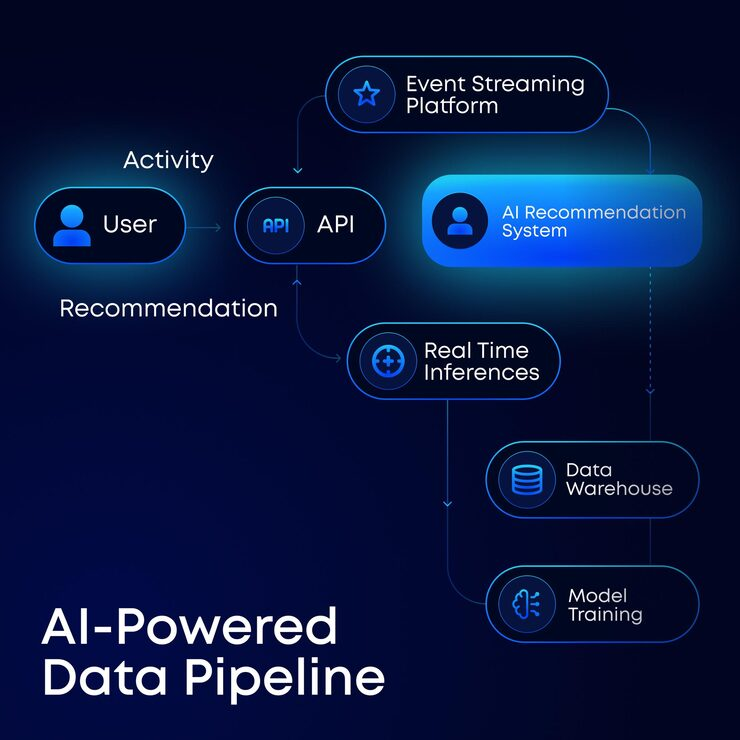

# 'AI-Powered Data Pipeline' diagram with outlined pill nodes and one glowing blue node

**Discipline:** print-social · **Design type:** Social educational post · **Design style:** Dark & Neon
**Tags:** diagram, ai, data-pipeline, navy, blue, flowchart, tech

## What it is
A square navy post showing a flow diagram: pill nodes with circular icons (User, API, Event Streaming Platform, Real Time Inferences, Data Warehouse, Model Training) joined by thin arrows, with 'AI Recommendation System' as a solid glowing blue node, and a large white title bottom-left.

## What it means
Technical but calm; one lit node shows where the intelligence sits, making architecture easy to scan.

## Techniques
- Draw a system as outlined pills linked by thin arrows.
- Fill and glow the single most important node.
- Label arrows with plain verbs of the data flow.
- Park a big title in empty corner space.

## Best for
- Tech architecture explainers
- AI product education
- Engineering blog visuals

## Vocabulary
- **Node** — A box in a diagram representing one component.
- **Flow diagram** — A chart showing how data or steps move.
