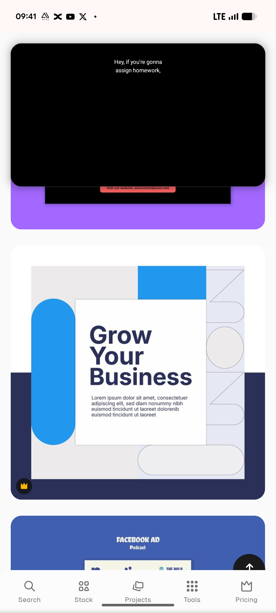

# Azure Pill Blocks Grow Your Business Template

**Discipline:** print-social ·  · **Design style:** Geometric & Bauhaus
**Tags:** business, azure, navy, pill, blocks, outline-shapes, square, template

## What it is
A stock-template preview of a square post on navy and pale grey with a large white card carrying a heavy navy headline 'Grow Your Business' and a paragraph, an azure vertical pill at the left, an azure block at the top and a column at the right of outlined arcs and a circle.

## What it means
Solid azure pills against fine outlined shapes create contrast between weight and lightness.

## Techniques
- Big card overlapping coloured blocks
- Solid pill and outline shapes in one composition
- Heavy navy headline over light body text
- Split navy and light background
- Fine-line geometric column on the right

## Best for
- Business promo templates
- Blue corporate social posts
- Geometric layouts

## Vocabulary
- **Overlap card** — A white card placed over background shapes.
- **Solid versus outline** — Mixing filled and outlined shapes for contrast.
- **Vertical pill** — A capsule standing on its end used as a shape.
