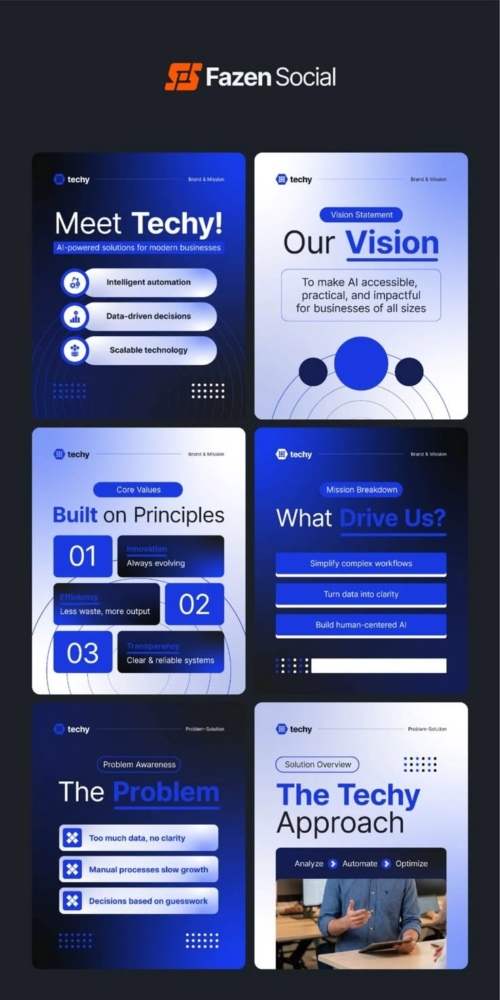

# Six navy and periwinkle posts for an AI company with glass list pills, concentric circle lines and dot clusters

**Discipline:** print-social · **Design type:** Social template pack
**Tags:** ai, navy, periwinkle, glass-pills, concentric-circles, dot-clusters, templates, brand-mission

## What it is
A dark board with a logo and six portrait posts alternating deep blue gradient and pale periwinkle: 'Meet Techy!' with three glossy list pills and icons, 'Our Vision' with circles, 'Built on Principles' with numbered tiles, 'What Drive Us?' with blue rows, 'The Problem' with tile list and 'The Techy Approach' with a photo card, each with an underlined blue keyword, a small tag pill and dot clusters.

## What it means
Clean and corporate; a consistent gradient and pill system makes an AI brand feel coherent.

## Techniques
- Underline one blue keyword in each title.
- Use glossy pill list items with icons.
- Add concentric circle lines and dot clusters.
- Alternate dark and light posts.

## Best for
- AI and tech company social sets
- Brand mission and vision posts
- Blue gradient systems

## Vocabulary
- **Keyword underline** — A coloured word with an underline in a title.
- **Glass list pill** — A glossy capsule listing an item.
- **Dot cluster** — A small grid of dots as decoration.
- **Concentric lines** — Circles drawn around a centre.
