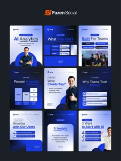

# Nine navy and royal-blue AI-service posts with portraits, tags and checklist cards

**Discipline:** print-social · **Design type:** Social template pack
**Tags:** ai, templates, navy, royal-blue, portrait, checklist, stats, agency

## What it is
A dark board headed with an agency logo above a 3x3 grid of deep-blue posts. Each mixes bold sans titles like 'AI Analytics' and 'Built For Teams' with cut-out professionals, small light-blue tag chips, white checklist cards and stat panels.

## What it means
Professional and clear; navy with light blue accents feels dependable for tech services.

## Techniques
- Combine navy backgrounds with pale-blue tag chips.
- Use white checklist cards as content blocks.
- Mix cutout portraits with data panels.
- Keep type in one bold sans.

## Best for
- AI and analytics service posts
- B2B social templates
- Tech consultancies

## Vocabulary
- **Tag chip** — A small pill labelling a topic.
- **Checklist card** — A card listing benefits with tick marks.
- **Stat panel** — A panel highlighting numbers.
- **Template grid** — A set of posts sharing structure.
