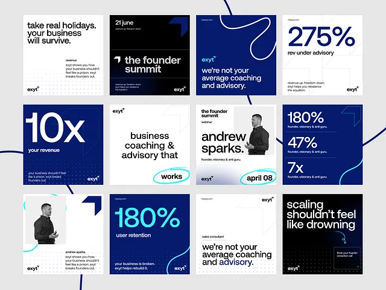

# Twelve navy, white and black coaching posts with giant stats, cyan hand-drawn loops and dot texture

**Discipline:** print-social · **Design type:** Social template pack
**Tags:** coaching, navy, white, cyan, stats, hand-drawn-loops, dot-grid, templates

## What it is
A 4x3 grid of square posts for a business-coaching brand: white posts with big black statements, navy posts with giant '10x', '275%', '180%' numerals, a black event card, a portrait card, cyan hand-drawn loops around key words and a thin navy line meandering between cards, all with a small logo mark.

## What it means
Confident and credible; giant numbers and cyan loops give warmth to a formal palette.

## Techniques
- Set giant stats as posts.
- Circle a key word with a cyan loop.
- Draw one continuous navy line across the grid.
- Add a subtle dot-grid texture.

## Best for
- Coaching and advisory brands
- Stat-led social systems
- Navy and cyan palettes

## Vocabulary
- **Cyan loop** — A hand-drawn ring around a word.
- **Continuous line** — A line crossing multiple posts.
- **Dot grid texture** — A faint dot pattern in the background.
- **Stat post** — A post built around one number.
