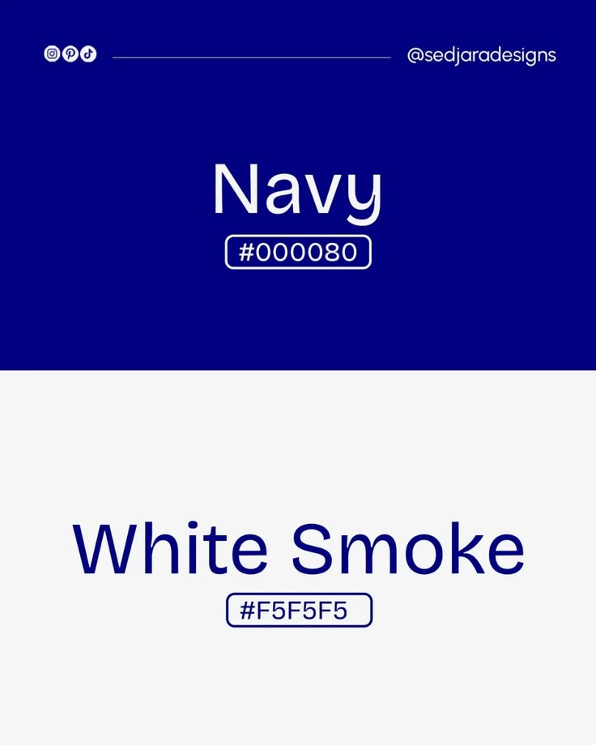

# Navy and White Smoke Colour Post

**Discipline:** print-social ·  · **Design style:** Minimalist
**Tags:** colour, navy, white, split, hex, minimal, palette

## What it is
A portrait post split into a saturated navy upper half with white text 'Navy #000080' and a white smoke lower half with navy text 'White Smoke #F5F5F5', hex codes in outlined pills and a handle strip at the top.

## What it means
Each colour appears as background and as text for its partner, proving the pairing.

## Techniques
- Swap colours between halves
- Colour name large and centred
- Outlined hex pill
- Handle header line with icons
- Two colours only

## Best for
- Colour palette posts
- Minimal two-colour layouts
- Design inspiration accounts

## Vocabulary
- **Colour pair** — Two colours chosen to work together.
- **Hex pill** — An outlined label with a colour code.
- **Inverted halves** — Two areas where foreground and background swap.
