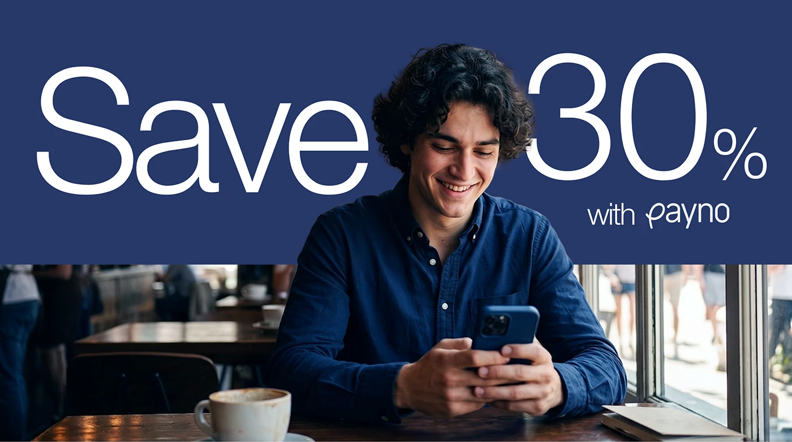

# Save 30% Banner with Cafe Portrait

**Discipline:** print-social ·  · **Design style:** Photographic & Cinematic
**Tags:** banner, navy, giant-type, photo, cafe, promo, overlap

## What it is
A wide banner with a navy top band carrying giant white light-weight 'Save 30%' and a small 'with payno', where a smiling man in a navy shirt with a phone rises from a cafe photo below into the band, overlapping the type.

## What it means
The person breaking into the headline band links the offer and the photo, and navy clothing keeps it on brand.

## Techniques
- Subject overlapping a solid headline band
- Very large light-weight numerals
- Navy wardrobe matching the band
- Small brand sign-off under the headline
- Cafe photo as the lower half

## Best for
- Promotional banners
- Fintech offers
- Photo-into-colour-block layouts

## Vocabulary
- **Band overlap** — A subject extending from a photo into a solid colour band.
- **Light-weight numerals** — Big numbers set in a thin typeface weight.
- **Sign-off** — A small brand mention closing a headline.
