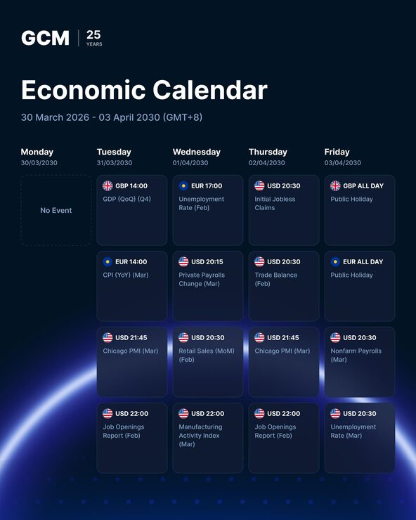

# Navy weekly 'Economic Calendar' grid with flag-labelled event cards and a glowing horizon

**Discipline:** print-social · **Design type:** Social educational post · **Design style:** Dark & Neon
**Tags:** finance, calendar, trading, navy, grid, flags

## What it is
A portrait navy post with a 'GCM 25 years' logo, 'Economic Calendar' title and date range, a Monday–Friday column grid of dark glassy cards each showing a country flag, currency and time (USD 20:30) with the release name, a dashed 'No Event' card, and a blue glowing planet arc at the bottom.

## What it means
Organised and trustworthy; flags make dense trading data instantly scannable.

## Techniques
- Lay out a week as a column grid of cards.
- Tag each item with a flag and time.
- Show empty slots with a dashed outline.
- Use a glowing horizon to lift a data-heavy post.

## Best for
- Trading brokers
- Finance newsletters
- Weekly schedule posts

## Vocabulary
- **Economic calendar** — A schedule of market-moving data releases.
- **Empty state** — How a slot with no content is shown.
