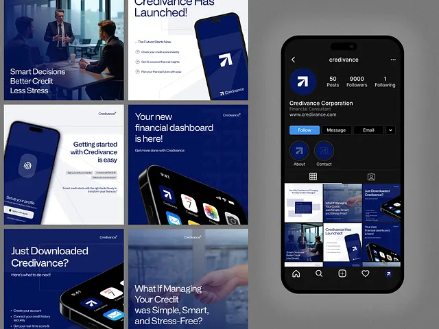

# Six navy and white credit-app posts with phones and office photos, plus a black Instagram profile mockup

**Discipline:** print-social ·  · **Design style:** Corporate & Clean-Tech
**Tags:** fintech, navy, white, phones, photo, instagram-profile, templates, arrow-logo

## What it is
A grey board with a 2x3 grid of square posts in deep navy and white (office meeting photo 'Smart Decisions Better Credit Less Stress', 'Credivance Has Launched!' with a phone and checklist, 'Getting started is easy' with a fingerprint screen, 'Your new financial dashboard is here!' with a phone in perspective) and a black Instagram profile mockup showing an arrow-in-blue-circle avatar, stats, buttons and the same grid.

## What it means
Trustworthy and corporate; navy plus a white arrow logo feels stable and forward-looking.

## Techniques
- Alternate navy and white posts.
- Feature the phone UI in perspective.
- Use business photography with a navy overlay.
- Show the whole feed in a profile mockup.

## Best for
- Fintech and credit app social sets
- Navy identity feeds
- Profile mockup presentations

## Vocabulary
- **Profile mockup** — A social profile page showing the feed.
- **Navy overlay** — A dark blue tint over a photo.
- **Perspective phone** — A phone angled across the frame.
- **Arrow avatar** — A profile picture with an arrow logo.
