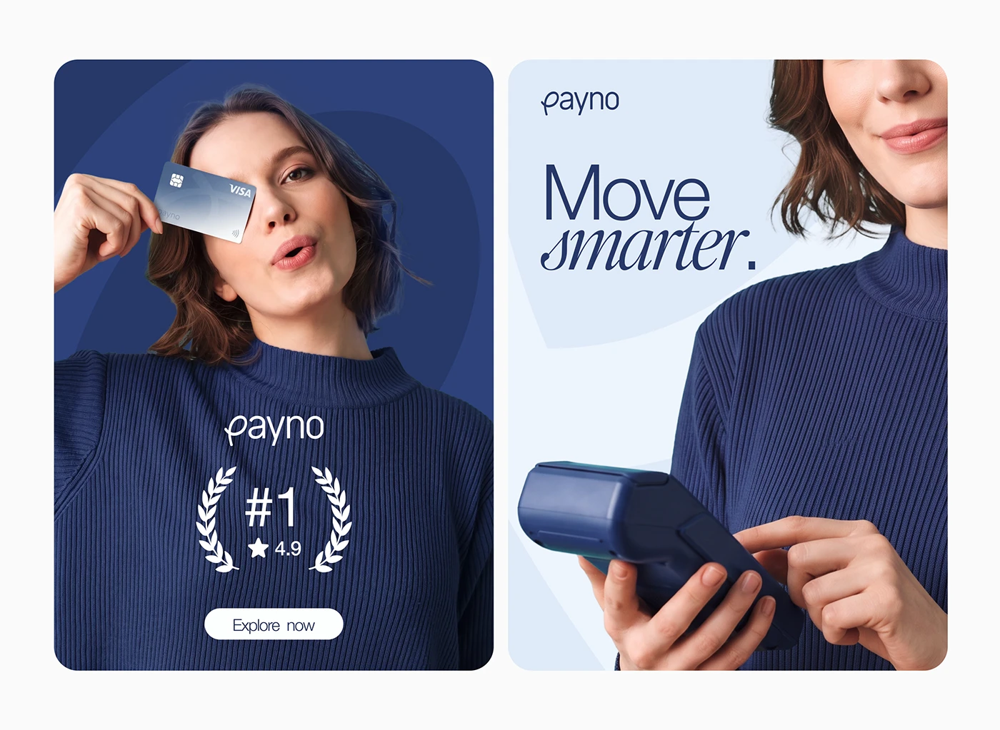

# Navy Portrait Ads with Card and Laurel

**Discipline:** print-social ·  · **Design style:** Editorial
**Tags:** ads, navy, portrait, laurel, serif-italic, card, payment-terminal

## What it is
Two portrait ads: a woman in a navy sweater holding a card over one eye against navy, with a wordmark, a #1 laurel with 4.9 stars and an Explore now button; and a pale panel with 'Move smarter.' in sans and italic serif beside a hand using a card terminal.

## What it means
Clothing that matches the brand blue makes photos feel designed, and the laurel adds trust.

## Techniques
- Model dressed in the brand colour
- Card held over the eye as a playful gesture
- Laurel badge with rating for trust
- Italic serif word in a sans headline
- Cropped close-up of a terminal in the second ad

## Best for
- Fintech app ads
- Rating and trust badge ads
- Photo-led social ads

## Vocabulary
- **Laurel badge** — A wreath around a ranking or rating.
- **Brand wardrobe** — Clothing chosen to match brand colours.
- **Product close-up** — A tight crop of a device in use.
