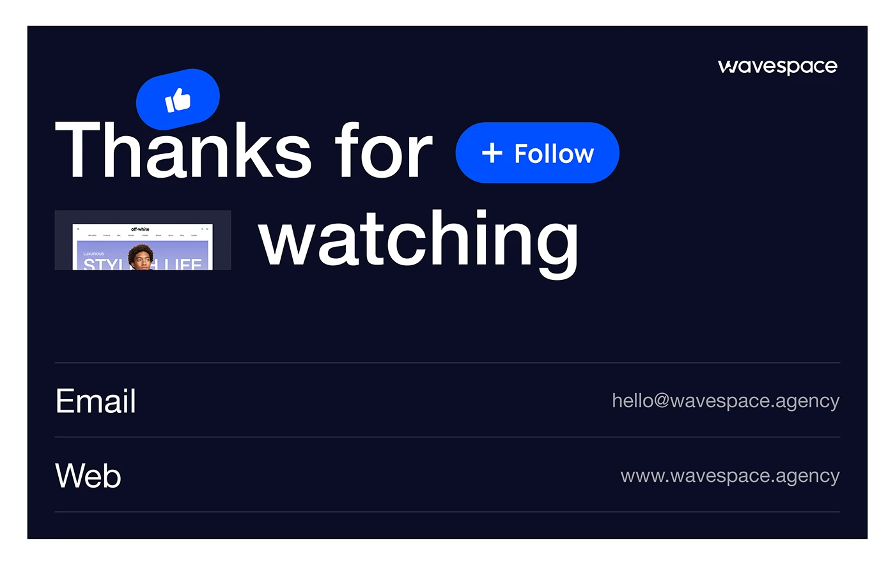

# Navy sign-off slide with 'Thanks for watching', follow pill and contact rows

**Discipline:** print-social · **Design type:** Presentation slides
**Tags:** closing-slide, navy, white, follow-button, thumbs-up, contact-rows, agency, hairline

## What it is
A deep navy slide with a huge white sans headline where a tilted blue thumbs-up pill and a blue '+ Follow' pill sit between the words, a small thumbnail of a website peeks in place of a word, and two hairline rows list Email and Web with values on the right.

## What it means
Friendly and social-native; the sign-off mimics platform buttons so viewers feel invited to follow.

## Techniques
- Insert UI-like pills (like, follow) between words of a headline.
- Replace a word with a live thumbnail of the work.
- List contact details as hairline rows with labels left and values right.
- Use one vivid blue on navy.

## Best for
- Case-study closing slides
- Agency sign-offs
- Social-platform-first portfolios

## Vocabulary
- **Inline UI pill** — A button-like graphic embedded within a headline.
- **Hairline row** — A list line separated by a thin rule.
- **Thumbnail word** — A small image standing in for a word.
- **Follow prompt** — A graphic urging viewers to follow.
