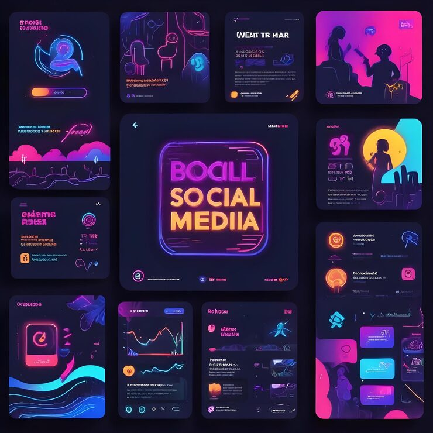

# Neon-on-black social media grid template kit

**Discipline:** print-social · **Design type:** Social template pack · **Design style:** Dark & Neon
**Tags:** neon, dark mode, instagram grid, gradient, glow, template pack

## What it is
A 3x4 grid of dark social post templates featuring neon pink/purple/orange gradients, glowing line icons, and a bold neon-outlined 'SOCIAL MEDIA' centerpiece card.

## What it means
A unifying near-black background lets varied neon gradient accents each pop individually while the grid as a whole still reads as one coherent brand kit.

## Techniques
- keep every card on near-black so neon gradient accents read as glowing
- use one card as an oversized 'title' anchor within the grid to break rhythm
- apply consistent glow/blur effects to icons and text for a unified light-emitting feel

## Best for
- nightlife/entertainment brand social kits
- gaming or tech influencer templates
- dark-mode content calendars

## Vocabulary
- **glow effect** — a soft blurred light halo applied around an element to simulate luminance
