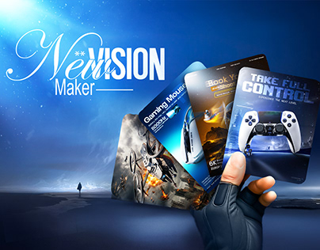

# 'New Vision Maker' cover: a gloved hand fans out gaming ad cards against a blue night sky

**Discipline:** print-social · **Design type:** Brand campaign visual · **Design style:** Photographic & Cinematic
**Tags:** gaming, portfolio, blue, cards, night, cover

## What it is
A deep blue dusk scene with a lone figure on a plain, a script-and-caps 'New VISION Maker' title, and a black gloved hand holding a fan of five portrait ad designs (gaming mouse, controller 'Take Full Control', headset) like playing cards.

## What it means
Confident and cinematic; the card fan presents a portfolio as a winning hand.

## Techniques
- Fan work samples like playing cards in a hand.
- Mix a script word with bold caps in the title.
- Set everything in a moody, lone-figure landscape.

## Best for
- Social media design portfolios
- Gaming ad showcases
- Behance covers

## Vocabulary
- **Card fan** — Items spread in an arc like held cards.
- **Mood scene** — An atmospheric backdrop that sets emotion.
