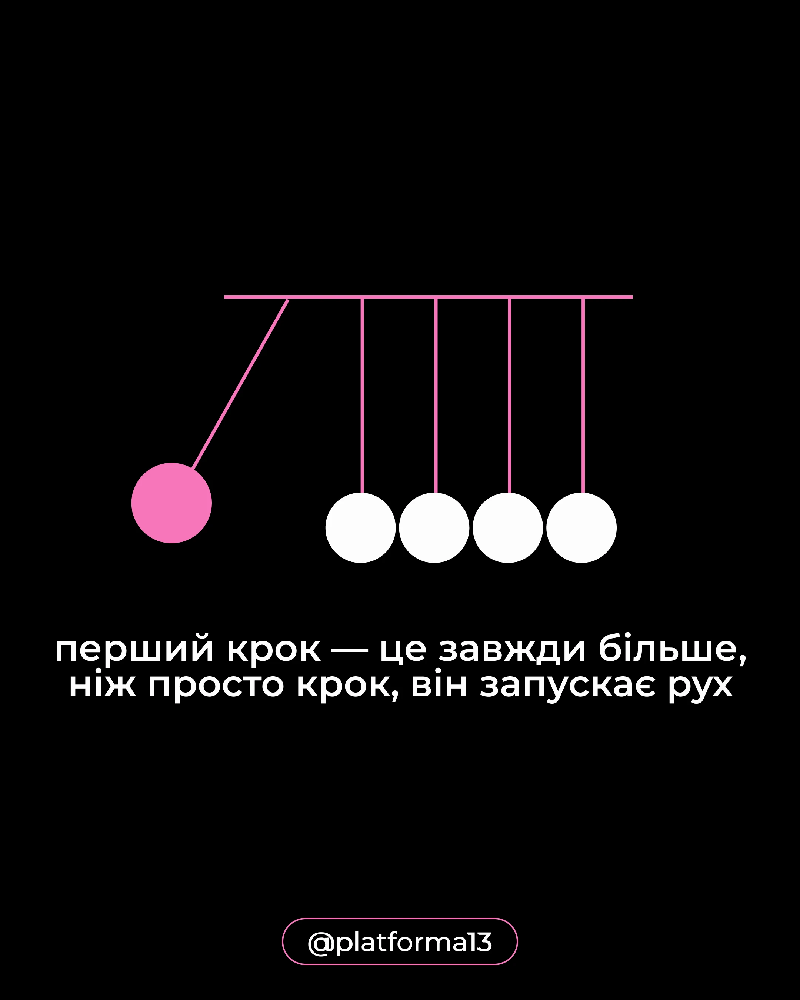

# Black post with a line-drawn Newton's cradle where one pink ball swings, and a white statement about the first step

**Discipline:** print-social · **Design type:** Social educational post
**Tags:** metaphor, black, pink, white, line-art, circles, minimal, cyrillic

## What it is
A pure black portrait with a pink horizontal bar and thin pink strings holding four white balls and one pink ball swung out at the left, a white two-line statement 'the first step is always more than a step, it starts movement' and a pink outlined pill with the handle.

## What it means
Simple and clever; a physical toy illustrates momentum with just circles and lines.

## Techniques
- Illustrate an idea with a simple physical object.
- Colour the moving element pink.
- Use white text on black.
- Keep the handle in an outlined pill.

## Best for
- Motivation and psychology posts
- Minimal metaphor graphics
- Black-and-pink systems

## Vocabulary
- **Physical metaphor** — A real-world object used to explain an idea.
- **Accent element** — The one part drawn in colour.
- **Line diagram** — An illustration made of thin lines and circles.
- **Handle pill** — An outlined capsule with the account name.
