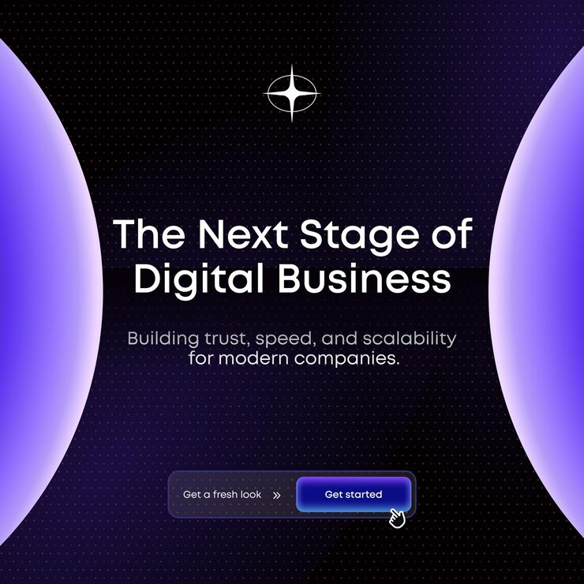

# 'The Next Stage of Digital Business' post with glowing violet planet edges and a split CTA

**Discipline:** print-social · **Design type:** Social promo post · **Design style:** Gradient & Aurora
**Tags:** business, violet, planet, cta, dark, minimal

## What it is
A square dark violet post on a faint dot grid with two huge glowing violet spheres cropped at left and right edges, a white four-point star, a centred headline and subline, and a split pill CTA ('Get a fresh look »' plus a glowing 'Get started' button with a hand cursor).

## What it means
Futuristic and inviting; the framing planets make the message feel like a portal.

## Techniques
- Crop two glowing spheres at opposite edges to frame text.
- Build a split CTA with a prompt and a button.
- Add a hand cursor to imply clicking.
- Use a dot grid background.

## Best for
- Tech agency posts
- SaaS launches
- Minimal CTA posts

## Vocabulary
- **Split CTA** — A pill with a text prompt and a button.
- **Edge crop** — A shape cut by the frame edge.
