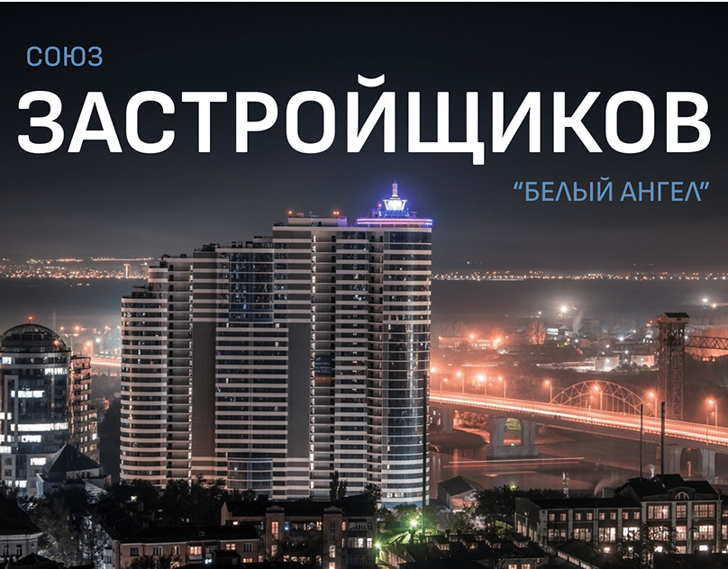

# Night photo of a lit residential tower with giant white caps and small blue labels

**Discipline:** print-social ·  · **Design style:** Dark & Neon
**Tags:** real-estate, night, city, white-caps, blue-labels, photo, cyrillic, cover

## What it is
A dark night cityscape with a tall striped tower with a glowing crown and a bridge of orange lights, a small blue 'СОЮЗ' at the top left, giant white 'ЗАСТРОЙЩИКОВ' across the top and a small blue name at the right.

## What it means
Bold and civic; the night lights give dignity to a developer association.

## Techniques
- Place giant caps across the dark sky.
- Use small blue labels as secondary text.
- Let a glowing tower be the hero.
- Keep the palette to night blues and warm lights.

## Best for
- Developer and property associations
- Night skyline covers
- Simple text-over-photo

## Vocabulary
- **Sky headline** — A large headline set in dark sky.
- **Small blue label** — A secondary text in blue.
- **Night skyline** — A city photo at night.
- **Landmark tower** — A prominent building as the subject.
