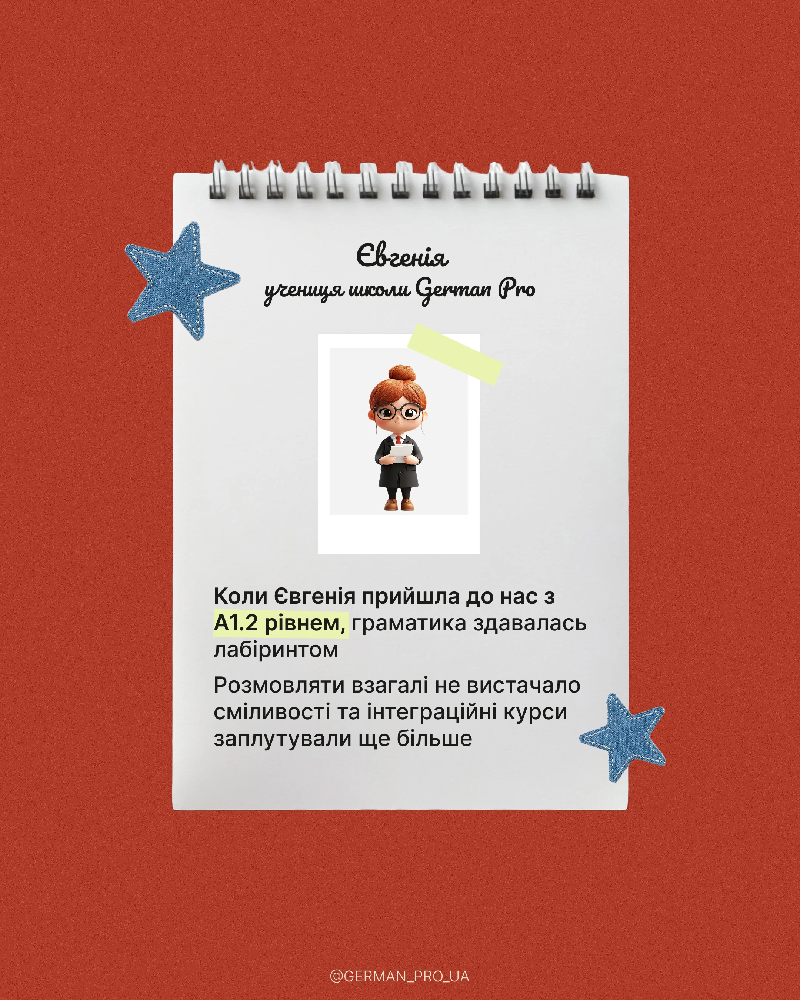

# Testimonial on a spiral notebook page with denim star patches on brick red

**Discipline:** print-social · **Design type:** Social testimonial post
**Tags:** testimonial, notebook, denim-patch, brick-red, 3d-character, polaroid, highlight, cyrillic

## What it is
A 4:5 post on grainy brick red. A white spiral-bound notepad page holds a script name and title, a taped instant photo of a 3D character, and a paragraph with one phrase highlighted in pale yellow. Two blue stitched denim star patches and a handle sit at the edges.

## What it means
Personal, tactile and trustworthy; the notebook feels like a real diary entry from a student.

## Techniques
- Use a realistic stationery object (notepad) as the content container.
- Tape a small photo or avatar to the page with a translucent strip.
- Highlight a key phrase with a marker-like yellow swipe.
- Add stitched patch stickers for texture.

## Best for
- Testimonials and student stories
- Education and coaching accounts
- Any post needing an authentic diary feel

## Vocabulary
- **Object container** — A physical item used as the frame for text.
- **Marker highlight** — A translucent yellow swipe behind words.
- **Tape accent** — A translucent strip attaching an image.
- **Patch sticker** — A stitched fabric-like badge.
