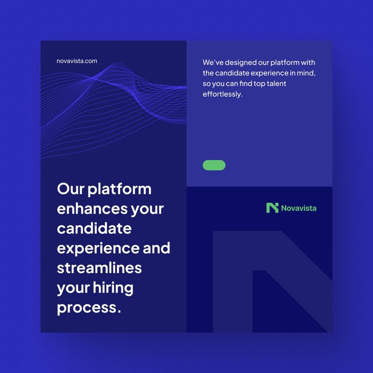

# Novavista candidate-experience post with a violet line-wave mesh and ghost N block

**Discipline:** print-social · **Design type:** Social promo post · **Design style:** Corporate & Clean-Tech
**Tags:** recruitment, hr-tech, navy, violet, line-wave, typography

## What it is
A square post in four navy and indigo blocks: a fine violet line-wave mesh at top-left above a large white headline ('Our platform enhances your candidate experience…'), short copy with a green pill at top-right, and a dark block with a green logo and ghost 'N' at bottom-right.

## What it means
Techy and calm; the line mesh suggests data and flow without literal UI.

## Techniques
- Add a fine line-wave mesh as a data texture.
- Split copy across quadrants for rhythm.
- Repeat the ghost letter across the series.

## Best for
- HR tech
- SaaS brand posts
- Typographic series

## Vocabulary
- **Line mesh** — Many thin lines forming a wavy surface.
- **Series consistency** — Shared elements across a set of posts.
