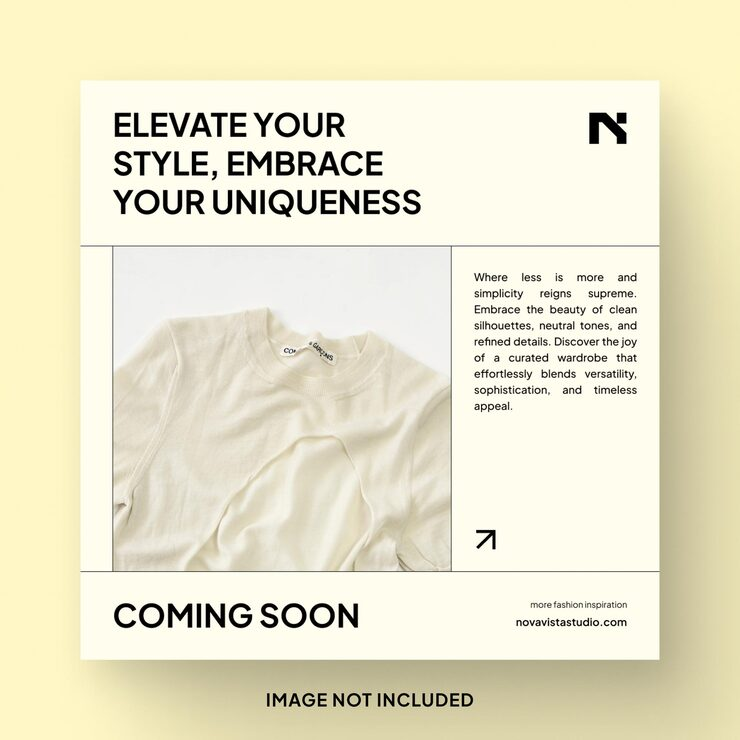

# Cream 'Elevate your style… Coming soon' post with a folded cream tee and justified side column

**Discipline:** print-social · **Design type:** Social promo post · **Design style:** Minimalist
**Tags:** fashion, coming-soon, cream, grid, minimal, apparel

## What it is
A square cream post with a three-line black uppercase headline and bold 'N' logo, a photo of a folded cream T-shirt in a ruled cell, a justified text column with an arrow icon, and a large 'COMING SOON' footer with URL.

## What it means
Understated and confident; tone-on-tone product and type tease a launch.

## Techniques
- Match product colour to background for tone-on-tone calm.
- Pair a photo cell with a justified text column.
- Put the launch status as a big footer line.

## Best for
- Product launches
- Apparel brands
- Teaser posts

## Vocabulary
- **Tone-on-tone** — Using shades of the same colour together.
- **Justified text** — Text aligned to both left and right edges.
