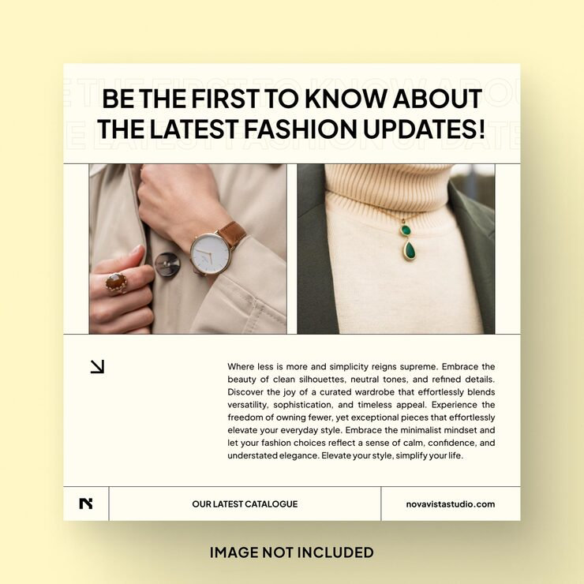

# Cream 'Be the first to know about the latest fashion updates!' post with outline-echo headline and ruled grid

**Discipline:** print-social · **Design type:** Social promo post · **Design style:** Minimalist
**Tags:** fashion, cream, grid, outline-type, minimal, catalogue

## What it is
A square cream post with a bold black uppercase headline over faint outlined repeats of the same text, two close-up photos (watch and rings, green drop pendant) in a thin ruled grid, an arrow icon, justified body copy and a footer row with 'N' logo, 'Our latest catalogue' and URL.

## What it means
Refined and editorial; the ruled grid and outline echo feel like a modern lookbook.

## Techniques
- Echo the headline in faint outline type behind it.
- Lay out content in a thin ruled grid.
- Use a footer row as a mini nav bar.
- Show accessory close-ups instead of full looks.

## Best for
- Fashion catalogues
- Jewellery brands
- Newsletter sign-ups

## Vocabulary
- **Outline echo** — Repeated outline text behind a solid headline.
- **Lookbook** — A collection of photos showing a fashion line.
