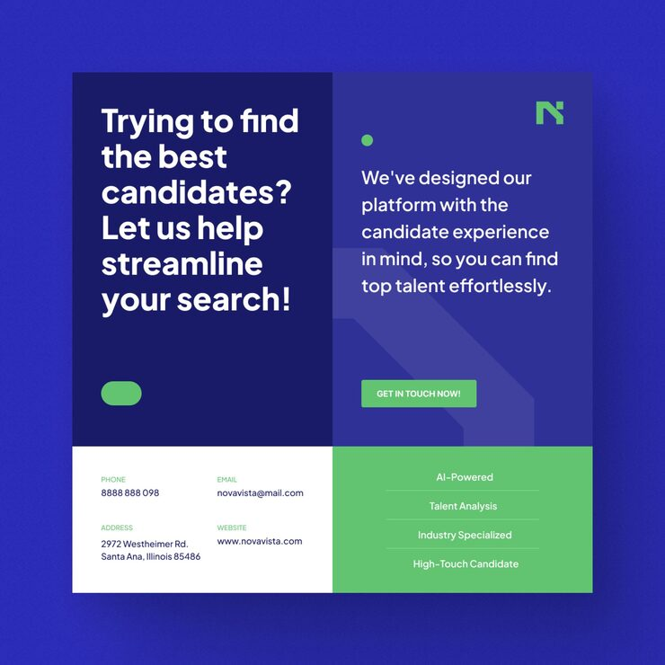

# Novavista 'Trying to find the best candidates?' post in navy grid blocks with a green feature list

**Discipline:** print-social · **Design type:** Social promo post · **Design style:** Corporate & Clean-Tech
**Tags:** recruitment, hr-tech, navy, green, grid, contact

## What it is
A square post divided into four blocks: navy with a big white question headline and green pill, indigo with a green N logo and short copy with a ghost 'N', white with labelled contact details (phone, email, address, website), and green with a ruled list of features (AI-Powered, Talent Analysis…).

## What it means
Organised and trustworthy; the grid makes a lot of information calm and scannable.

## Techniques
- Divide the square into four functional blocks.
- Put a ghost logo letter behind copy.
- List features with thin dividers in a colour block.
- Label contact fields in small green caps.

## Best for
- HR tech platforms
- Recruitment agencies
- B2B info posts

## Vocabulary
- **Block grid** — A layout of rectangles each with a role.
- **Ghost letter** — A large faint letterform used as background.
