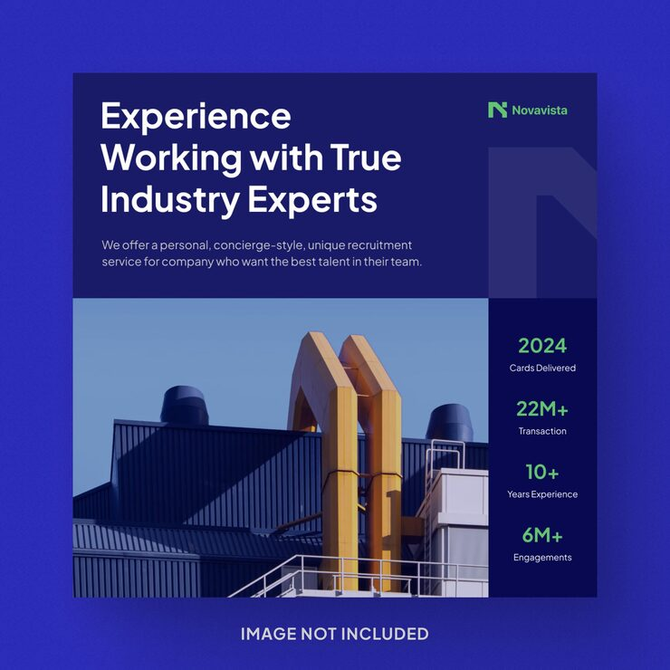

# Novavista 'Experience Working with True Industry Experts' post with green stats column and industrial photo

**Discipline:** print-social · **Design type:** Social promo post · **Design style:** Corporate & Clean-Tech
**Tags:** recruitment, stats, navy, green, industrial, photo

## What it is
A square navy post with a white headline and copy, a large photo of blue industrial rooftops with bright yellow pipes, and a narrow dark column of green stats (2024 Cards Delivered, 22M+ Transaction, 10+ Years Experience, 6M+ Engagements).

## What it means
Credible and bold; the yellow pipes pop against blue while stats add proof.

## Techniques
- Stack key stats in a narrow side column.
- Choose a photo whose accent pops against the palette.
- Keep headline large and left-aligned.

## Best for
- Recruitment firms
- B2B credentials
- Company stats posts

## Vocabulary
- **Stat column** — A vertical list of numbers and labels.
- **Colour pop** — A contrasting colour that draws the eye.
