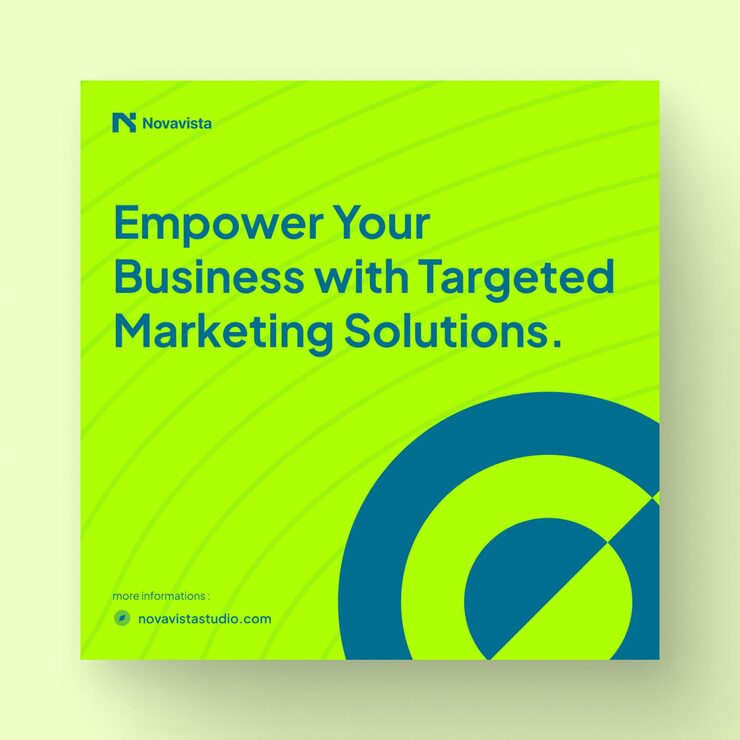

# Novavista lime post with teal headline and bold concentric target rings

**Discipline:** print-social · **Design type:** Social promo post · **Design style:** Geometric & Bauhaus
**Tags:** agency, lime, teal, geometric, target, minimal

## What it is
A square lime post with a teal N logo, teal headline 'Empower Your Business with Targeted Marketing Solutions.', faint arc lines, and a big teal concentric-ring target sliced diagonally in the bottom-right corner.

## What it means
Fresh and punchy; the target literally illustrates 'targeted' with pure geometry.

## Techniques
- Turn the headline's key word into a geometric symbol.
- Slice a shape diagonally for tension.
- Use a two-colour palette with strong contrast.

## Best for
- Marketing agency posts
- Performance marketing
- Two-colour brand systems

## Vocabulary
- **Concentric rings** — Circles sharing one centre.
- **Visual pun** — A graphic that literally shows a word's meaning.
