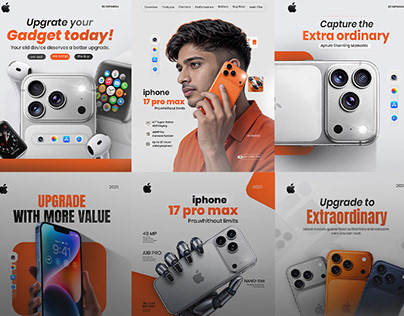

# Six orange, grey and white smartphone promo posts with product renders and bold headlines

**Discipline:** print-social · **Design type:** Social ad set
**Tags:** electronics, smartphone, orange, grey, product-render, bold-headline, ads, grid

## What it is
A 3x2 grid of posts for phone retail: headlines like 'Upgrade your Gadget today!' with gadget renders, a portrait of a man holding an orange phone, 'Capture the Extra ordinary' with lens close-ups, and bold black 'UPGRADE WITH MORE VALUE' cards, all in orange and grey with rounded orange shapes.

## What it means
Punchy and commercial; orange rounded blocks make products feel active.

## Techniques
- Frame product renders with big orange shapes.
- Use bold headlines with tight leading.
- Alternate portrait and product posts.
- Keep grey backgrounds.

## Best for
- Electronics retail ads
- Product launch sets
- Orange-grey brands

## Vocabulary
- **Product render** — A rendered product image.
- **Orange block** — A big rounded orange shape behind the product.
- **Retail ad set** — Multiple ads for a store or product line.
- **Lens close-up** — A macro of the camera module.
