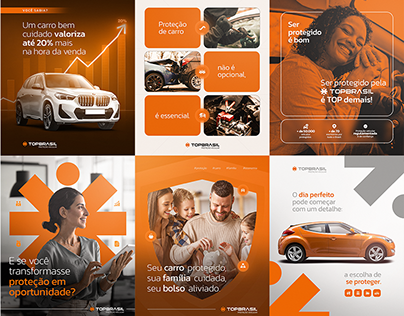

# Six orange and white car-protection posts with photos, a rising arrow chart and abstract shapes

**Discipline:** print-social ·  · **Design style:** Geometric & Bauhaus
**Tags:** insurance, automotive, orange, white, photo-cutout, arrow-chart, geometric, portuguese

## What it is
A 3x2 grid of posts in saturated orange with white and grey: a car with a rising line chart, cropped car-damage photos in rounded tiles, a smiling woman in a car, a professional in an abstract asterisk shape, a family in an orange cutout, and an orange car on white with grey geometric shapes.

## What it means
Trustworthy and warm; orange gives energy to an insurance product.

## Techniques
- Fill posts with one orange and photos.
- Use rounded photo tiles.
- Add abstract geometric shapes.
- Alternate orange and white.

## Best for
- Insurance and automotive ads
- Orange brands
- Photo-led ad sets

## Vocabulary
- **Rounded photo tile** — A photo cropped with rounded corners.
- **Arrow chart** — A rising line with an arrowhead.
- **Abstract shape** — A geometric form as decoration.
- **Single-hue ad set** — Ads in one dominant colour.
