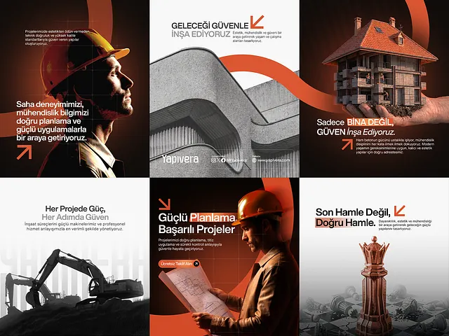

# Six construction posts in orange, black and white with a swoosh ribbon, arrow glyphs and helmets

**Discipline:** print-social · **Design type:** Social template pack
**Tags:** construction, orange, black, white, swoosh, arrows, photo, turkish

## What it is
A 3x2 grid mixing dark photo posts of engineers in orange helmets with an orange swoosh ribbon across, a white post with concrete architecture and an orange arrow, a house held in a hand, an excavator silhouette on white, a chess piece, and headlines in bold sans with orange keywords and small arrow icons.

## What it means
Confident and industrial; the orange ribbon ties photography across posts.

## Techniques
- Run an orange swoosh across photos.
- Use a small orange arrow glyph beside headlines.
- Highlight keywords in orange blocks.
- Alternate dark and light posts.

## Best for
- Construction and engineering social sets
- Orange-black brands
- Ribbon-linked layouts

## Vocabulary
- **Swoosh ribbon** — A curved band crossing images.
- **Arrow glyph** — A small diagonal arrow icon.
- **Keyword block** — A coloured highlight behind a word.
- **Dark/light alternation** — Posts switching background tone.
