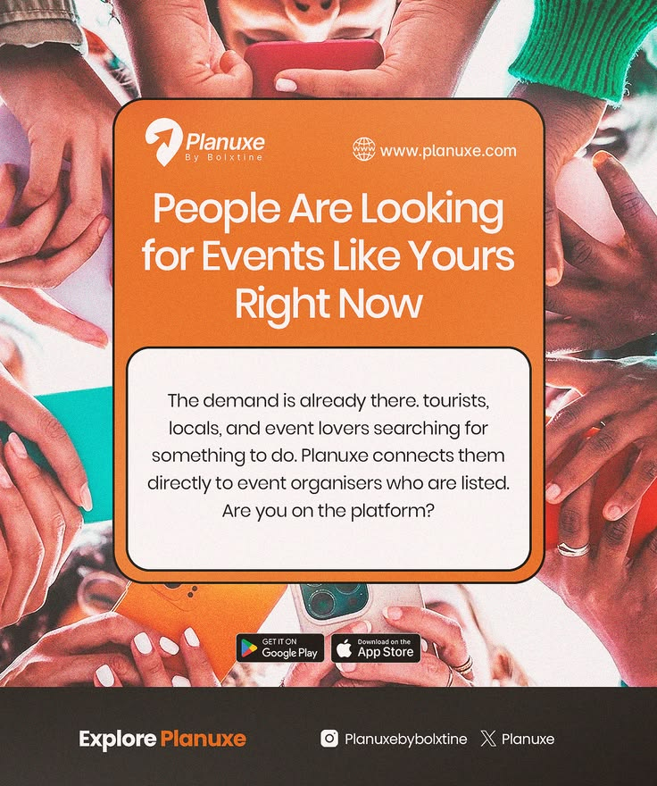

# Rounded orange card and white message box over a circle of hands with phones, with store badges

**Discipline:** print-social ·  · **Design style:** Warm & Organic
**Tags:** events, app, orange, white-card, hands, photo, store-badges, rounded

## What it is
A portrait ad with a top-down photo of many hands holding phones, overlaid with a rounded orange card carrying a logo, URL and 'People Are Looking for Events Like Yours Right Now' and an inset white box with a paragraph, plus a bottom brown bar with Google Play and App Store badges and social handles.

## What it means
Energetic and communal; a ring of hands says everyone is searching.

## Techniques
- Overlay a rounded card on a busy photo.
- Nest a white text box inside the orange card.
- Add store badges at the base.
- Use a warm-toned photo.

## Best for
- Event and marketplace app ads
- Photo-plus-card layouts
- Orange brand promos

## Vocabulary
- **Card over photo** — A solid card placed over an image.
- **Nested box** — A white box inside a coloured card.
- **Store badge** — App store download buttons.
- **Hands circle** — A top-down ring of hands.
