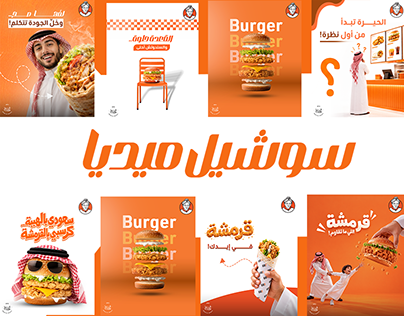

# Orange fast-food social set with Arabic calligraphic headline

**Discipline:** print-social · **Design type:** Social ad set
**Tags:** food, social-ads, orange, arabic, burger, photo-cutout, brand-mascot, grid-overview

## What it is
A portfolio thumbnail of a restaurant's social posts. Eight squares in saturated orange feature burgers, wraps, and figures in traditional Gulf dress, with a large white Arabic script title in the middle.

## What it means
Appetising, warm and energetic; the single orange makes the whole set feel like one brand.

## Techniques
- Choose one saturated brand colour and tint every post with it.
- Repeat the hero product in large outsized type or stacked repeats behind it.
- Blend photos of people with product for a local, friendly voice.
- Place a big calligraphic title between two rows to label the collection.

## Best for
- Restaurant and quick-service brands
- Social media portfolio thumbnails
- Regional campaigns with Arabic typography

## Vocabulary
- **Colour-flood** — Filling the whole composition with one brand colour.
- **Stacked repeat** — Repeating a word or object in layers for emphasis.
- **Arabic script display** — A decorative, fluid Arabic headline style.
- **Thumbnail grid** — A collage of many posts used as a cover.
