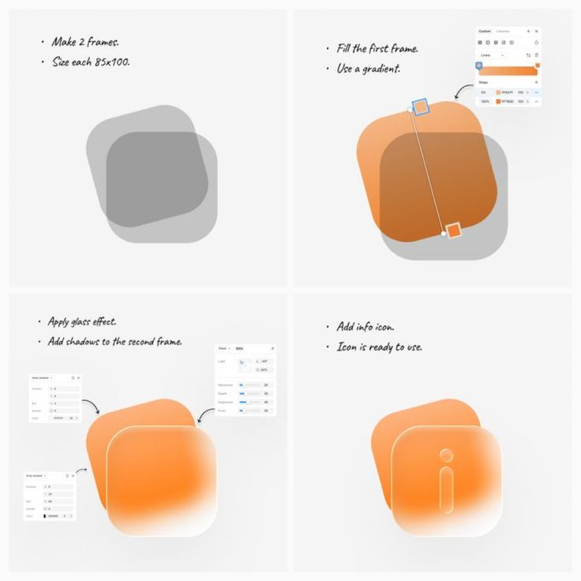

# Orange Glass Icon Four-Step Tutorial

**Discipline:** print-social ·  · **Design style:** Glassmorphism
**Tags:** tutorial, glass, orange, script-font, steps, figma, icon

## What it is
A 2x2 grid tutorial in handwritten script: two grey frames, a gradient fill, a glass effect with shadows and property panels, and the finished orange glass 'i' icon.

## What it means
Small panel screenshots and hand-written notes feel like a designer's sketchbook. The build-up to the glowing final tile is satisfying.

## Techniques
- Four equal cells that build progressively
- Handwritten bullet notes over a clean grey field
- Callout arrows pointing to real UI property panels
- Final cell shown fully rendered as a reward
- One warm colour throughout

## Best for
- UI tutorial posts
- Design tool tips
- Icon and effect walkthroughs

## Vocabulary
- **Glass effect** — A translucent, refractive treatment applied to a shape.
- **Callout arrow** — A curved arrow linking a note to a specific control.
- **Progressive grid** — A grid where each cell adds to the previous one.
