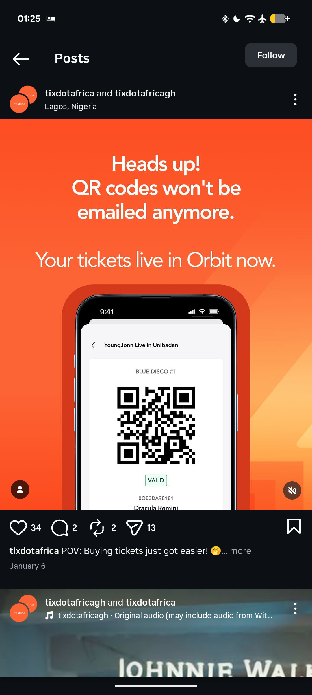

# Orange QR Ticket Notice with Phone

**Discipline:** print-social · **Design type:** Social ad
**Tags:** notice, orange, qr-code, ticket, phone-mockup, announcement, instagram

## What it is
A vivid orange gradient post with a large white centred message 'Heads up! QR codes won't be emailed anymore.' and a lighter line 'Your tickets live in Orbit now.', above a phone in a darker red-orange frame showing a ticket with a large QR code and a green VALID tag.

## What it means
A full-bleed orange gives the notice urgency, and showing the ticket screen tells users where to look.

## Techniques
- Full-bleed single-colour ground
- Two-tier white headline with different weights
- Phone cropped by the bottom edge
- Tonal frame around the phone in a darker orange
- Small green status tag inside the UI

## Best for
- Service change announcements
- Ticketing and event apps
- Urgent notices with a product visual

## Vocabulary
- **Tonal frame** — A frame in a darker shade of the background colour.
- **Status tag** — A small label such as VALID showing a state.
- **Notice post** — A post announcing a change users need to know.
