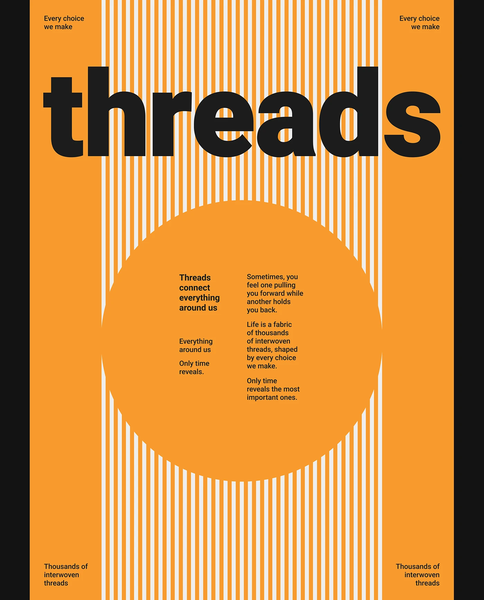

# Orange poster with a giant black 'threads' over white vertical stripes and a solid circle of text

**Discipline:** print-social · **Design type:** Typographic posters
**Tags:** poster, orange, black, stripes, circle, giant-type, swiss, minimal

## What it is
A poster in orange with a central band of thin white vertical stripes, a huge black lowercase 'threads' cutting across them, and a solid orange circle interrupting the stripes with two small columns of text. Small text repeats in the four corners on a black frame.

## What it means
Bold and rhythmic; stripes are literal threads and the circle a moment of pause.

## Techniques
- Use stripes to illustrate the word.
- Interrupt the pattern with a solid circle for text.
- Set one giant lowercase word across the top.
- Repeat small text in all corners.

## Best for
- Poster series
- Swiss-style graphic design
- Concept-driven typography

## Vocabulary
- **Stripe field** — A band of repeated thin lines.
- **Circle cutout** — A solid circle breaking a pattern.
- **Corner text** — Small copy set in all four corners.
- **Concept pattern** — A pattern that visualises the topic.
